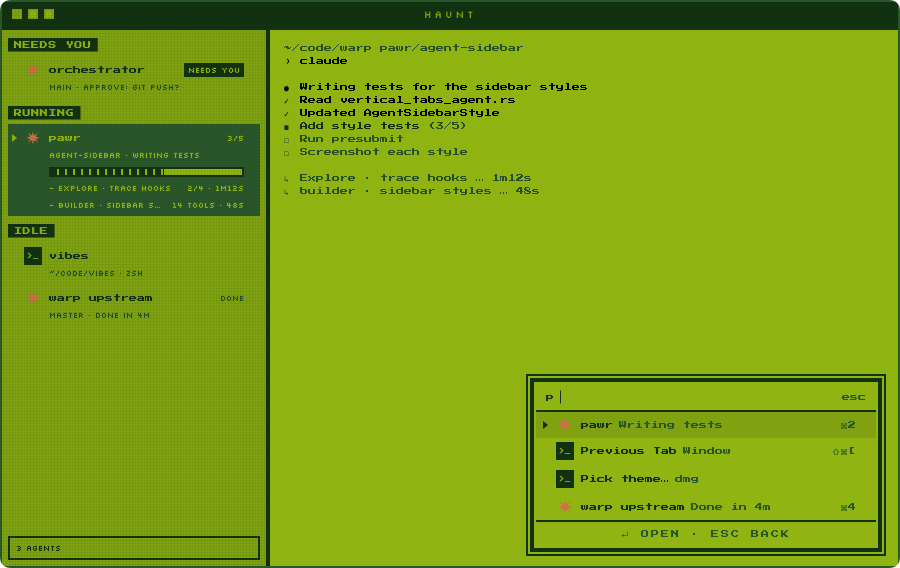

# DMG

A Haunt theme in four greens on a dot-matrix screen. A faint LCD grid lies over the sidebar. Group labels sit inverted on dark blocks, the selected tab is a dark row behind a triangle cursor, and progress shows as blocks in a framed track. The title bar is a dark strip with three square buttons and a tracked "HAUNT". ⌘K opens a palette in nested rings with its own triangle cursor.



## Install and switch

From the repo:

```sh
haunt plugin install .
```

Switch to it from ⌘K ▸ Pick theme…, or set it in `~/.haunt/config.toml`:

```toml
theme = "dmg"
```

A copy you install yourself draws only the UI with its fonts, so the terminal falls back to your own monospace font. Press Start 2P draws the terminal only when the theme ships with Haunt.

## Fonts

| Font | Use | Licence |
| --- | --- | --- |
| Press Start 2P | tab names, title, terminal, palette | SIL Open Font License 1.1, [OFL-PressStart2P.txt](OFL-PressStart2P.txt) |
| Silkscreen | UI | SIL Open Font License 1.1, [OFL-Silkscreen.txt](OFL-Silkscreen.txt) |

The theme itself is MIT ([LICENSE](LICENSE)).

## Effects

`theme.toml` turns on these `[effects]` keys. Haunt's [themes guide](https://github.com/highskore/haunt/blob/main/docs/themes.md) describes each one.

- Window: `window.square`, `window.border`, `titlebar.rule`, `lights.shape = "squares"`
- Sidebar: `label.rule = "block"`, `label.case`, `row.select = "cursor"`, `row.inset`, `name.font = "display"`, `needs.pill`, `progress.style = "segments"`, `bar.done`, `sidebar.footer`
- Palette: `palette.inset`, `palette.font`, `palette.icons`, `palette.selection = "cursor"`, `palette.foot`, `palette.scrim`, `palette.keys`, `palette.tab.sub`

Its `[app]` table draws the palette's rings (`palette.rings`) and the rule above its hints (`palette.foot.rule`), and its `[strings]` word those hints and the subagent prefix ("- ").

## Layers

Three `[[layer]]` tables draw the rest:

- `lcd-window` and `lcd-sidebar`: the LCD's pixel grid, every 3 pt, at 7%.
- `foot-frame`: the 2 pt box around the agent count.

The grid is a pattern, so where its lines cross it stays at 7% rather than darkening. Views without a layer slot, such as the title bar, don't get it.
